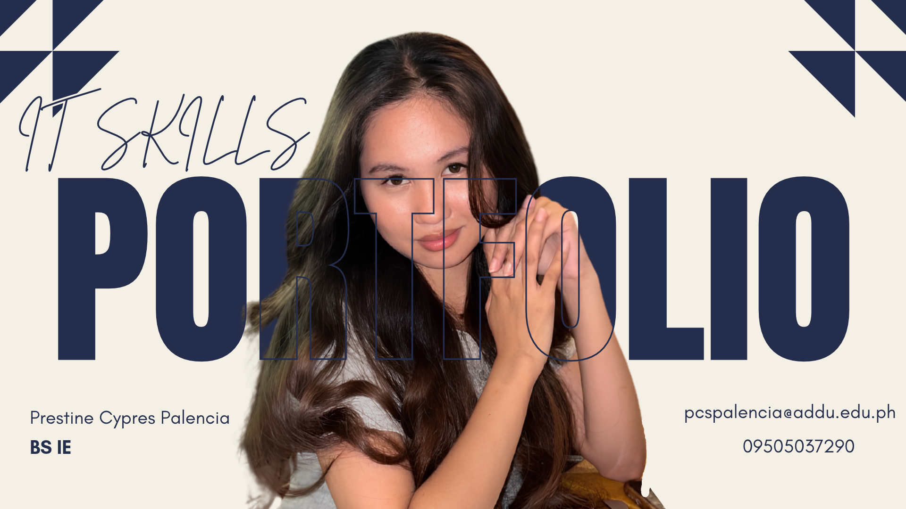
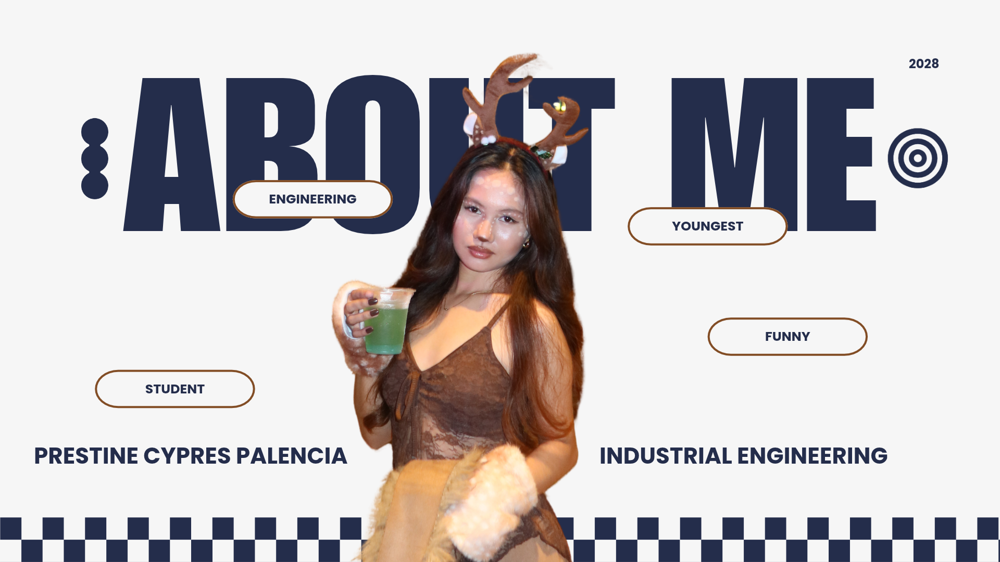

<div align="center">
  
</div>

# GE 4120 — Activities Portfolio

**Developing Digital Competence for the Modern World**  
An exploration of 21st Century IT Skills through digital literacy, productivity tools, visual communication, data management, artificial intelligence, and technology-assisted content and website development.


</div>

---

## About Me

<div align="center">
  
</div>

## ✦ ABOUT ME | Get to Know Me

<div align="center">

### 👋 Hello there! I'm **Prestine Cypres S. Palencia**

*Industrial Engineering Student • Digital Learner • Aspiring Innovator*

📍 Island Garden City of Samal, Philippines  
🎓 Third-Year BS Industrial Engineering Student  
🏡 Youngest of three siblings

</div>

---

### 🌷 A Little About Myself

I'm **Prestine Cypres S. Palencia**, a third-year Bachelor of Science in Industrial Engineering student at **Ateneo de Davao University**. I come from the beautiful **Island Garden City of Samal**, where I grew up as the youngest among three siblings.

As a student, I'm passionate about discovering how things work, finding better ways to solve problems, and learning new technologies. My interests include process optimization, production planning, quality control, ergonomics, and data analysis.

I also enjoy exploring digital tools and artificial intelligence to enhance creativity, improve productivity, and turn ideas into meaningful outputs. I believe that continuous learning and adapting to technology are essential skills in today's ever-changing digital world.

### 💻 SKILLS & TOOLS

*Exploring the digital skills and technologies that help me learn, create, analyze, and innovate.*

| ✦ Category | 🛠️ Skills & Tools |
|---|---|
| **📊 Productivity & Office Tools** | Microsoft Word, Excel, PowerPoint, Google Docs, Google Sheets, Google Workspace |
| **🤖 Artificial Intelligence** | Prompt Engineering, AI-assisted Content Generation, AI-assisted Website Development |
| **🎨 Digital Creativity** | Visual Design, Presentation Design, Typography, Color Coordination |
| **📈 Data & Analysis** | Data Analysis, Statistical Analysis, Spreadsheet Formulas, Data Visualization |
| **⚙️ Industrial Engineering** | Work Study and Measurement, Time Study, Method Study, Process Analysis, Workflow Improvement, Ergonomics, Production Planning |

---

<div align="center">

### ✨ MY PERSONAL MOTTO

*"Learn continuously, create meaningfully, and improve endlessly."*

🌐 **Exploring Technology • Building Skills • Embracing Innovation**

</div>
---

## ✨ ACTIVITY PORTFOLIO
### My Learning Journey in 21st Century IT Skills

Welcome to my collection of **GE 4120 activities!** This portfolio showcases my learning journey, creativity, and practical application of digital skills throughout the course. From presentation design and data management to artificial intelligence and website development, each activity represents an opportunity to explore, create, and grow in the digital world.

---

### 📚 Explore My Activities

| No. | Activity | Description |
|:---:|---|---|
| **01** | 🎨 [Presentation Design Principles](Activity-01/README.md) | Applying visual hierarchy, alignment, contrast, proximity, and repetition to create effective presentations. |
| **02** | 🌈 [Color Palette and Typography](Activity-02/README.md) | Exploring color combinations, typography, and visual consistency in digital design. |
| **03** | 💧 [HYDR8 — Infographic & Mini Project](Activity-03/README.md) | Presenting a smart hydration product concept through creative visual communication and documentation. |
| **04** | 📊 [Google Sheets Presentation](Activity-04/README.md) | Exploring spreadsheet functions, formulas, charts, and data organization. |
| **05** | 🤖 [Exploring and Improving AI Prompts](Activity-05/README.md) | Understanding how clear instructions and effective prompting improve AI-generated outputs. |
| **06** | 🏎️ [REDRIDE — Website Development](Activity-06/README.md) | Exploring AI-assisted website development through the creation of a vehicle rental platform. |
| **07** | 📄 [Professional Resume Generation](Activity-07/README.md) | Exploring AI-powered resume creation and evaluating professional presentation and content. |

---

<div align="center">

### 🚀 LEARN • CREATE • INNOVATE

*Every activity is another step toward becoming a more digitally capable and adaptable learner.*

</div>
---

## Repository Structure

```text
GE-4120-PORTFOLIO/
│
├── README.md
│
├── images/
│   ├── GE 4120 Activities Portfolio.png
│   └── Profile photo of Prestine Cypres Palencia.png
│
├── Activity-01/
│   ├── README.md
│   └── files/
│
├── Activity-02/
│   ├── README.md
│   └── files/
│
├── Activity-03/
│   ├── README.md
│   └── files/
│
├── Activity-04/
│   ├── README.md
│   └── files/
│
├── Activity-05/
│   ├── README.md
│   └── files/
│
├── Activity-06/
│   ├── README.md
│   └── files/
│
└── Activity-07/
    ├── README.md
    └── files/
```

---

## Contact

- **Email:** [pcspalencia@addu.edu.ph](mailto:pcspalencia@addu.edu.ph)
- **Phone:** [09505037290](tel:09505037290)

---

<div align="center">

<sub>GE 4120 · Academic Activities Portfolio · Industrial Engineering</sub>

**Learning • Creating • Improving**

</div>
